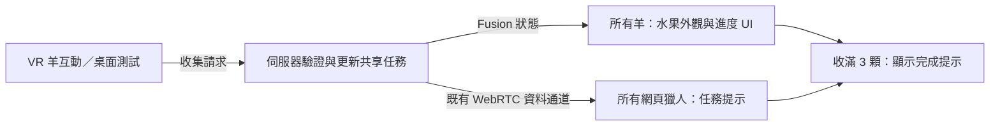

# MainGame 多人化排查與實作規劃

日期：2026-11-15。檢查分支：`single-to-multi`。

## 本階段目標與已確認規則

- 正式角色為 VR 羊與網頁 CCTV 獵人；桌面玩家僅供開發測試。
- 所有羊共享進度，合計收集 3 顆蘋果。
- 收集完成後，向羊端及已連線的網頁獵人顯示完成提示。
- 後續設計是開啟出口並逃脫；本階段不製作出口、逃脫判定或勝負結算。
- 本次只排查與規劃，沒有修改場景、Prefab、遊戲程式或 Build Settings。

## 檢查範圍與證據限制

已讀取新舊 MainGame 的 Unity YAML、Prefab 與覆寫、場景設定、目前 Fusion 流程、單機玩家與蘋果程式、NPC 權限、CCTV／道具處理與驗收入口。

這是靜態排查，未啟動 Unity Play Mode、重新建置或執行頭盔／瀏覽器測試。以下區分可直接由檔案確認的缺口與仍須執行驗證的風險。既有驗收報告不能證明本次替換後的新場景已通過。

工作目錄原本已有 MainGame、場景 meta、Build Settings 等變更，以及舊分離場景的刪除；這些既有變更均保留。

## 目前可沿用的基礎

| 基礎 | 目前實作 | 使用方式 |
| --- | --- | --- |
| 連線與房間 | `ConnectionManager`、`ServerConnectionManager`、`NetworkSessionController` | 沿用 Fusion Server／Client，不引入第二套網路架構 |
| 載圖與開始分離 | `LobbySessionState` 的 Lobby → LoadingMainGame → AwaitingStart → Running | 進入地圖後仍須等伺服器按 Start Game 才可收集 |
| 玩家登記與姿態 | `NetworkWorld`、`VRNetworkAvatar`、`NetworkInputSource` | 用 Fusion 識別請求來源，沿用現有頭手姿態同步 |
| 網路 NPC | `RandomNPCSpawner`、`NetworkNpcAuthorityGate` | 沿用伺服器生成、AI／生命狀態同步 |
| 地圖入口 | 新 MainGame 仍包含 `MapNetworkSetup.prefab` | Stage 2 與出生點基礎仍在，無須整個重建 |
| 網頁獵人通道 | `CCTVViewSwitcher` 的 WebRTC DataChannel | 用既有通道傳送任務狀態與完成提示 |
| 驗收工具 | `Tools/ConnectionFlow/Test-Fusion.ps1` | 擴充必要的任務測試，保留原連線回歸 |

玩家位移目前是客戶端送結果、伺服器接受與轉送，並非完整伺服器模擬移動。本階段可延續；收集距離仍須由伺服器檢查。這不能被解讀為已能防止所有位移作弊。

## 已確認的缺口

### 1. 新 MainGame 不在啟用的建置場景清單：最先修正

`Assets/Resources/NetworkSceneSettings.asset:16` 指向 `_flow test/MainGame.unity`，但 `ProjectSettings/EditorBuildSettings.asset` 啟用的是 `MainGame_old.unity`，沒有啟用新 MainGame。

新場景 GUID 為 `042e801a001155e4ba368a62eb507221`，MainGame_old 保留 `57876576fd74d5047857e5731c264978`，兩者不是同一個資產。

`ServerConnectionManager.LoadMainGame()`（第 83–92 行）按設定中的路徑找 build index；目前預期取得 -1 並顯示 `Enable MainGame in the build scene list.`，不是自動改載 MainGame_old。

待做：啟用正確的新 MainGame，核對所有端使用相同的場景清單與建置版本，再測試實際載圖。備份場景可以保留，不必刪除。

### 2. 單機玩家仍會在各端自行啟動

新場

現有連線流程已另外保留本機 VR rig，桌面測試又會生成 `DesktopTestPlayer`；把新場景直接載入各端，會有重複控制器、相機、AudioListener 或輸入處理的風險。

待做：多人場景停用單機 Player_cap，保留現有連線流程管理的本機 rig。單機移動程式可留在原測試用途，不需要把整套跳躍／蹲下功能搬進桌面測試玩家。

### 3. 吃蘋果完全是本機狀態，且只認單機玩家

- `FruitPickup.cs:8–15`：本機 bool 去重、直接呼叫 `FruitManager.Instance`、本機 `SetActive(false)`。
- `FruitPickup.cs:17–38`：Trigger 必須找到 `PlayerControl` 才能登記可互動水果。
- `PlayerControl.cs` 的 Interact 直接呼叫 Collect；VR 玩家沒有這條互動路徑。
- `FruitManager.cs:5–24`：全域 static Instance 與本機計數；沒有 Fusion 狀態或伺服器驗證。
- 全域 static Instance 在同一 Editor 多 Runner 測試中也可能指向另一個場景副本。

結果：一端吃掉不代表其他端消失；兩人同吃可能各算一次；VR 沒有收集入口。

### 4. 收滿目前只有 Console 訊息

`FruitManager.cs:22–24` 只寫出「任務完成！出口開啟！」，沒有真正開門、切場景或廣播。

本階段待做：把顯示文字改為「蘋果已收集完成」之類準確提示，同步給所有羊與網頁獵人。完成提示不代表對局已結束。

### 5. 新場景有啟用的非網路羊 AI

新加入的 `SK_Sheep_white_final` 實例掛有啟用的 `AnimalNPC`、NavMeshAgent 與 `AnimalMotionController`，但不是目前的網路 NPC prefab。其 `AnimalNPC.Start/Update` 會自行選路與更新。

既有 `NPC_Preview_cow.001`、`NPC_Preview_sheep` 的 AnimalNPC 則已停用，不能把所有預覽動物一概當成仍在執行的 AI。

待做：確定新羊是展示物還是遊戲 NPC；展示物停用 AI，需要參與遊戲的 NPC 改用目前伺服器生成的網路 prefab。避免各端獨立抽路線，也避免 AwaitingStart 時已開始遊戲 AI。

### 6. 任務 UI 與網頁完成訊息尚未接上

場景的 `AppleUI` 是各端自帶的普通 Canvas；`FruitManager` 直接修改圖示。它沒有依 Runner 綁定，也沒有 VR 顯示配置。

`CCTVViewSwitcher` 有各網頁的資料通道與狀態回傳，但目前沒有共享蘋果任務的訊息處理。獵人瀏覽器使用 WebRTC connection ID，並不是 Fusion 的 PlayerRef；不能把瀏覽器當成已在 Fusion 玩家名單內。

待做：羊 UI 訂閱所屬 Runner 的任務狀態；VR 使用現有可見 UI 位置或適合的 world-space 提示；網頁以同一伺服器任務資料更新自己的提示。

## 需優先執行驗證的整合風險

1. **CCTV 顯示與伺服器可見性。** `ServerConnectionManager` 在 Multi-Peer 會將 Server 設為不可見；`ConnectionTestViews` 又按目前檢視切換可見性。舊 `ServerOnly` 呼叫的是 Legacy `SessionLauncher.RefreshRunnerVisibility()`，不能據此認定新流程已保證 CCTV 持續渲染。必須以網頁實測確認；若切到羊端後 CCTV 黑畫面，再修正目前流程的渲染控制。
2. **ServerOnly 啟動與清理。** 新 `NetworkSessionController` 沒有舊流程的 OnSceneLoadDone → ActivateFor 保底回呼，目前依賴 `ServerOnly.Start` 自行查 Runner。需檢查各端是否只有權威端連到 signaling，以及載圖／離線後是否正確清理。
3. **VR 能否實際抵達三顆蘋果。** 目前姿態來源會讀 rig root 與頭手，但這不能證明頭盔中的移動、碰撞與互動按鍵已可用。先在裝置驗收，依結果補必要的走動／互動，不能用桌面飛行測試代替。
4. **場景仍設定 60 隻網路 NPC 與兩個示範物件。** MapNetworkSetup prefab 預設生成 60 隻 NPC；新場景覆寫仍指定 NetworkMovingBox／NetworkSwitch。應確認正式地圖所需數量，停用不需要的示範生成。先以少量 NPC 驗收任務，再測目標容量。
5. **AI 搜尋範圍。** `AnimalNPC` 空 waypoint 清單的 fallback 會搜尋所有場景物件；網路 spawner 已傳入自己的場景清單。新增的場景 AI 應避免走全域 fallback，防止 Multi-Peer 混用 waypoint。
6. **獵人其他功能的掛載。** 新場景與 CCTV prefab 沒有序列化 MoneyManager／ShopManager／ItemUseManager 綁定；程式存在不等於此場景可用。本階段只要求原有 CCTV 可運作並收到提示，不順帶重做商店或道具。

提供 CCTV 的程序需要圖形渲染。Fusion 的 `GameMode.Server` 是網路角色，不等於 Unity Dedicated Server 建置；本階段沿用可渲染的伺服器程序較直接。Unity Dedicated Server 建置會移除渲染相關工作與 GPU-only 資產，不適合直接當目前的相機串流來源。[Unity 官方說明](https://docs.unity.com/en-us/engine/6000.0/manual/platform-specific/dedicated-server/get-started/optimizations)

## 建議最小實作

### 共享任務資料

在 MainGame 的地圖入口配置一個場景所屬的 Fusion 任務物件，保存「三顆蘋果的收集遮罩」。每顆固定 index 0／1／2，完成數與 completed 可從遮罩推導，避免再維護一份容易不一致的計數。

三顆固定場景水果不需要各自新增完整網路物件。`FruitPickup` 可保留水果位置、index 與本機外觀更新；`FruitManager` 收斂為讀取共享狀態的 UI。狀態更新只切換水果的顯示／可互動元件，不直接停用任務 NetworkObject。

任務物件跟 MainGame 場景生命週期走；離開地圖後清除，再次進地圖從 0/3 開始。尋找資料時使用所屬 Runner／場景的明確綁定，取代全域 FruitManager.Instance。

### 收集請求

VR 的本機互動入口，以及桌面測試入口，都呼叫同一個收集請求。VR 先採「靠近後按一個指定互動鍵」即可；確切控制器按鍵需依現有輸入設定與頭盔測試選定。

伺服器收到請求時檢查：

1. 來源是本房間已登記的玩家，位於 MainGame，遊戲 Phase 為 Running。
2. 正式遊戲來源為 VR 羊；桌面測試角色只在測試設定允許。
3. 該羊有有效追蹤資料，水果 index 有效且尚未收集。
4. 以伺服器已接收的羊／頭部世界位置，檢查與該水果的互動距離。不得接受客戶端自報「已碰到」就直接加分。
5. 同一個伺服器處理步驟內檢查並設定收集 bit，讓兩位玩家同時請求同一顆時只成功一次。

RPC 用於發送收集請求；共享結果使用 `[Networked]` 狀態，讓 UI／水果能從當前狀態重建。只廣播一次性 RPC 無法保存任務結果，Photon 官方也要求需要保留的 RPC 結果寫進網路狀態。[Photon RPC 文件](https://doc.photonengine.com/fusion/v2/manual/data-transfer/rpcs)

### 完成提示與網頁橋接

- 羊端觀察共享狀態由未完成轉為完成，各顯示一次提示。
- 伺服器將同一份狀態經 CCTV 的既有資料通道送給每個已連線網頁。
- 建議最小訊息：`{ "type": "mission-status", "collected": 3, "required": 3, "completed": true }`。
- 網頁首次連線／重新連線時也回傳當前快照，不能只等下一次「完成」事件。
- 同一輪重複收到快照時不重複彈出完成提示；重新載入地圖後重設 UI。
- 完成後維持 3/3、不再接受重複收集；不切換勝負狀態，不生成出口。

## 實作順序與完成標準

| 順序 | 工作 | 主要檔案／資產 | 完成標準 |
| --- | --- | --- | --- |
| 1 | 修正場景契約、停用單機玩家與獨立 AI，確認 CCTV 基礎 | EditorBuildSettings、MainGame、NetworkSceneSettings；必要時目前的可見性控制 | Server 與兩個 Client 都載入新 MainGame；每端只有自己的本機控制器；網頁看得到正確世界 |
| 2 | 加入場景任務狀態、收集驗證、兩種互動入口 | 新增最小任務 NetworkBehaviour／本機互動元件；調整 FruitPickup、FruitManager 與地圖入口 | A 吃第一顆、B 吃第二顆，兩端都看到 2/3；同吃第三顆只變成 3/3 |
| 3 | 接上完成提示與網頁狀態快照 | 羊端 UI、CCTVViewSwitcher、實際網頁訊息處理頁面 | 所有羊與已連線獵人收到一次完成提示；網頁重連仍顯示 3/3 |
| 4 | 回歸測試、獨立程序與頭盔驗收 | 現有 ConnectionFlow 工具與新增的針對性任務測試 | 下列驗收全部通過；以同一份新建置測試各端 |

先完成 1–3 的最小可玩流程，再處理實測暴露的效能問題，不在這次遷移中順帶重寫移動、AI 或網路框架。

## 必做驗收

- [ ] 未按 Start Game 時，不能收集；修正後沒有額外的單機 AI 提前運作。
- [ ] 兩名羊分別收集不同蘋果，所有端的水果消失與共同進度一致。
- [ ] 兩名羊同時收集同一顆，只增加一次；重送／連按／已收集 index 不增加進度。
- [ ] 過遠、無效 index、錯誤角色、錯誤場景、追蹤無效的請求被拒絕。
- [ ] 第三顆收集後，所有羊與兩個獨立瀏覽器各收到一次提示，CCTV 畫面持續運作。
- [ ] 網頁中途連上或重連，收到目前進度；不用等待再吃一顆。
- [ ] 一位羊離線後，另一位的已收集進度保留；全數離線可依原流程正常停止與清理。
- [ ] 返回選單並建立新一輪後，回到 0/3，沒有舊 Singleton、事件訂閱或提示殘留。
- [ ] Multi-Peer 的不同場景副本不共用 UI／水果參考，切換檢視不使 CCTV 停止渲染。
- [ ] 獨立 Server／Client 新建置與真實 VR 頭盔完成靠近、互動、UI 可見性驗收。
- [ ] 執行既有 Assets／Editor 回歸；再執行 Standalone 與代表性 WeakNetwork 測試。長時間／60 隻 NPC 測試在基本流程通過後進行。

目前載入 MainGame 時會關閉 Fusion 房間加入，不承諾進行中羊玩家中途加入或斷線續接。網頁重連是另一條通道，仍需本階段處理狀態快照。

## 後續階段，這次不實作

- 出口模型、開門狀態、出口 Trigger 與逃脫判定。
- 一隻逃出即全隊勝利或每隻各自逃脫、羊方全滅／超時等勝負規則。
- 獵人命中 VR 玩家的效果與玩家生命狀態。目前 `ItemProjectile`／測試彈體處理的是 `NetworkNpcAuthorityGate`，`VRNetworkAvatar` 沒有對應的玩家生命／捕獲狀態；不能把 NPC 擊殺視為已完成 PvP。
- 商店／收入／道具在新場景的完整掛載，以及它們與對局階段的統一限制。
- 嚴格的伺服器移動驗證、羊玩家重新連線與主機移轉。

## 執行時注意

沿用 `Tools/ConnectionFlow/README.md` 的驗收入口。`ConfigureMapNetworkSetup.cs`、其他 Configure 工具會修改資產，不能把它們當成純檢查直接重跑；開始實作時先審查預期修改與目前組員場景內容。

本文件完成代表排查與規劃已整理，不代表上述多人流程已實作或通過執行驗收。
